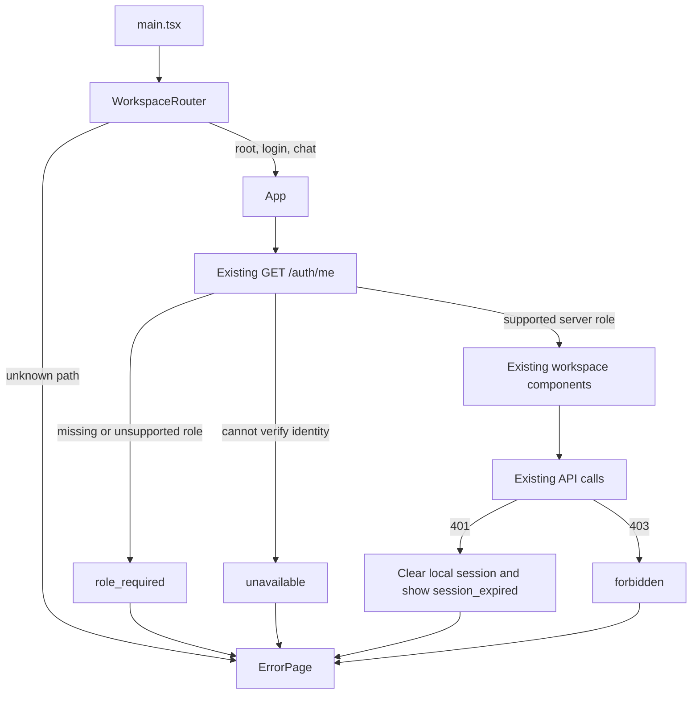

# Frontend recovery states

Scope: F-06/F-09/F-10, 13 November 2026. Local working tree; no deployment.

## Reference and existing structure

The local KWAIX portfolio `Q:\KWAIX\tjowk\app\not-found.tsx` supplies the design
reference: centered terminal icon, status panel and a return action. KPP adapts
that composition to its blue palette, industrial drawing grid and plain recovery
copy. The live kwaix.dev page could not be fetched; this is a source-based
adaptation, not a verified match to the deployed website.

No standalone wireframe/Figma export was found in the searched repository.
The current reference is `project-plan.md` section 8 and the actual dashboard,
login and chat in `src/App.tsx`. Existing navigation selects component state;
there is no routing package. This change adds an entry-path fallback without
introducing a router dependency or rewriting that navigation.

## Wireframe

```text
Jenga Consultants / Product Copilot                 Workspace / Recovery

                         [status icon]
                             404
                        PAGE NOT FOUND
                   This page is off the plans.
                   Explanation and next action

                  +-- jenga / workspace --------+
                  | status   page_not_found      |
                  | next     return_to_workspace |
                  +------------------------------+

                 [Return to workspace] Open assistant
                        Short encouragement

Built for the work ahead.                        Jenga Consultants / Demo
```

`ErrorPage` shares this composition across not-found, permission, missing-role,
expired-session and identity-service failure states. It uses local CSS/icons,
responsive layout, visible keyboard focus, focused heading, descriptive title
and no animation. It displays neither protected resource identifiers nor raw
backend denial messages. No fake request-access workflow is offered.

## Component and state relationships



- `/`, `/login`, `/chat` enter the existing app; `/chat` opens the chat screen
  after login. Unknown paths and `/404` render not-found.
- `/403`, `/access-denied`, `/role-required`, `/session-expired` expose the
  corresponding public recovery views; visiting them grants no permission.
- Authenticated calls route 401/403 to recovery; failed login stays inline.
  Resource 404, validation/media failures and rate limits retain their existing
  contextual handling. A masked resource 404 is not turned into a revealing 403.
- Restoring a saved session checks `/auth/me` before catalogue/history requests.
  The stored role key is retained as a display cache, never read as authority.
  Missing roles do not expose a role chooser.
- Sign-in recovery attempts the existing logout endpoint and clears local
  protected state. Network failure cannot guarantee server revocation.
  Local logout also aborts active chat/media fetches; aborted results are ignored
  and cannot refill the conversation after recovery. History fetches are aborted
  when their session changes. Browser verification of these transitions remains
  pending.
- Backend authorization, routes and JSON shapes are unchanged. Existing UI-only
  engineer page restrictions are retained; aligning comparison/media navigation
  with both-role product requirements is a separate F/B review item.
- Nginx/Vite still use SPA fallback, so a not-found view can have HTTP 200.
  This change does not claim server-rendered HTTP 404 semantics.

## Verification and owner review

Recorded result: 8 focused tests passed; frontend lint and TypeScript/Vite
production build passed (final Vite phase 5.79 s). Low-memory build environment:
`NODE_OPTIONS=--max-old-space-size=384 --v8-pool-size=1`, `RAYON_NUM_THREADS=1`,
scoped to that command and restored afterward. Production-preview HTTP checks
returned the SPA entry for six URLs; they do not execute React or verify layout.

Run `node --test tests/frontend_error_states.test.mjs`, `npm run lint`,
`npm run build` (use the documented low-memory settings on Athena).
The tests use installed React server rendering, not a browser. They cover
path classification, API error distinctions, safe recovery content and a
tampered saved role being unable to render the workspace before identity checks.

Browser host/native pipe were unavailable. Pending visual/device checks:
320px/desktop layouts, heading focus, recovery clicks, real expired-session
401, restricted-resource 403, missing-role identity and backend outage.
No visual or live end-to-end authentication pass is claimed.

Review requested in this handoff: F checks composition/navigation; B checks
`/auth/me`, 401/403 and sign-in recovery; A checks that source/media errors remain
contextual. No cross-role approval is recorded.
